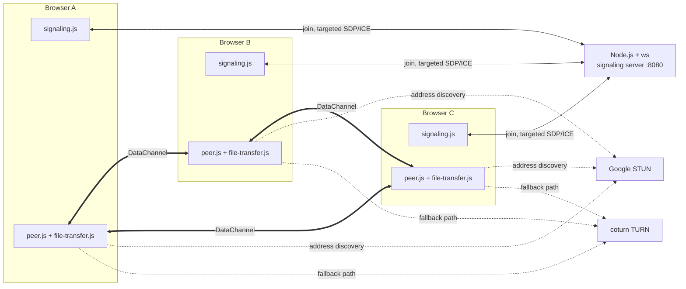

# Beam — Project Report

**Peer-to-peer group chat and file transfer over WebRTC DataChannels**

| | |
|---|---|
| Project | Beam (`beam-p2p-chat`) |
| Type | Technical recruitment task / WebRTC demonstration |
| Client | HTML5, CSS3, vanilla JavaScript (ES2020), no framework or build step |
| Server | Node.js ≥ 18, `ws` only |
| Transport | WebRTC DataChannel (DTLS/SCTP); WebSocket for signaling |
| NAT traversal | STUN (Google) and TURN (coturn via Docker Compose) |
| Report date | 9 November 2026 |

## 1. Executive summary

Beam is a group chat in which **messages and files never pass through the
server**. The Node.js process is a rendezvous point: it serves the static client,
lets browsers in the same room exchange SDP and ICE candidates, and enforces a
configurable room limit. Once each pair of peers is connected, chat text and file
bytes use encrypted WebRTC DataChannels directly between browsers.

The implementation keeps the original stack and module split while moving from a
single remote peer to a full mesh. A room now holds up to four participants by
default (configurable 2–8), with one `RTCPeerConnection` and one DataChannel per
pair. Signaling is targeted by peer id, messages show their sender, and files are
sent to a selected peer. Short signaling disconnects preserve existing media
paths, and server restarts remap live sessions instead of duplicating them.

The work was verified with Node syntax checks, a signaling integration suite
using real WebSocket clients, and a three-tab headless Chrome run. The browser
run covered mesh chat, per-peer file targeting, a 40,000-byte multi-chunk
transfer with a matching SHA-256, chat during a signaling outage, and recovery
after a server restart. A live TURN relay test was **not** possible because the
Docker daemon was not running; the Compose file was validated only.

## 2. Objectives and scope

The refinement had four goals:

1. Preserve the must-have requirements: vanilla client, `ws` server, the six
   named client modules, signaling-only-server behavior, explicit statuses,
   STUN/TURN configuration, candidate queueing, backpressure, safe DOM
   rendering, heartbeat, and server-side input limits.
2. Implement the four bonuses: file transfer, group chat via mesh,
   disconnect/reconnect recovery, and STUN/TURN relay configuration.
3. Reduce unnecessary complexity without removing behavior needed for a mesh:
   one reconnect policy, one heartbeat, session-keyed transfers, and clear
   comments around perfect negotiation and ICE restart.
4. Verify behavior and rewrite the documentation so it matches the code and the
   tests actually run.

Out of scope: authentication, persistence, an SFU, file-transfer resume, and
production TURN credential management.

## 3. Requirements traceability

| Requirement | Implementation | Status |
|---|---|---|
| HTML/CSS/ES2020, no framework or build | Six classic scripts and one stylesheet | Met |
| Node.js + `ws` only | `server/index.js`; `package.json` has one dependency | Met |
| Keep named client modules | `config`, `signaling`, `peer`, `file-transfer`, `ui`, `app` | Met |
| Server never carries chat/files | Relay whitelist only handles offer, answer, candidate; join/leave only manage room membership | Met |
| Group chat over a mesh | `sessions` map; one session per remote peer | Met |
| Configurable room limit, default 4 | `MAX_PEERS_PER_ROOM`, clamped to 2–8 | Met |
| Targeted signaling by peer id | `to` sent by client; `from` assigned by server | Met |
| Sender shown per message | Peer label in the message metadata | Met |
| Candidate queueing | `pendingCandidates` flushed after remote description | Met |
| Backpressure | High/low water marks with `bufferedamountlow` | Met |
| Safe rendering | `textContent` / `createElement` only | Met |
| Server heartbeat | Protocol ping every 30 s, terminate on missed pong | Met |
| Server input limits | Room validation, `clientId` validation, 256 KB payload cap | Met |
| Path traversal protection | Resolved static path must stay inside `client/` | Met |
| File transfer bonus | 16 KB chunks, metadata, progress, reassembly | Met |
| Disconnect/reconnect bonus | Capped backoff, 20 s seat grace, ICE restart, remapping | Met |
| STUN/TURN bonus | ICE server list, coturn Compose file, `?relay=1` | Met; relay path not executed |
| Documentation | This report plus rewritten README | Met |
| No fabricated test results | Only observed checks reported; TURN marked untested | Met |

## 4. System architecture

Three external roles exist: the signaling/static server, STUN, and TURN. Only the
first is application code.



The DataChannel edges carry all user content. Losing the signaling server
removes only the thin edges; established DataChannels continue.

Layering:

```text
index.html + styles.css        presentation
app.js                         mesh state and wiring
ui.js | peer.js | file-transfer.js | signaling.js
config.js                      settings
```

Only `app.js` mutates application state. The other modules expose functions or
callbacks and do not know about the room as a whole.

Repository layout and line counts:

```text
client/index.html             205 lines
client/styles.css             945 lines
client/js/config.js            59 lines
client/js/signaling.js        162 lines
client/js/peer.js             342 lines
client/js/file-transfer.js    279 lines
client/js/ui.js               424 lines
client/js/app.js              713 lines
server/index.js               386 lines
docker-compose.yml / .env.example / package.json
README.md / PROJECT_REPORT.md
```

Approximately 3,500 lines including HTML and CSS.

## 5. Signaling protocol

Client to server:

| Type | Fields | Meaning |
|---|---|---|
| `join` | `room`, `clientId` | Join once per socket |
| `offer` / `answer` | `to`, `description` | Relay an SDP description to one peer |
| `candidate` | `to`, `candidate` | Relay one ICE candidate to one peer |

Server to client:

| Type | Fields | Meaning |
|---|---|---|
| `joined` | `room`, `peerId`, `clientId`, `resumed`, `limit`, `peers` | Join accepted |
| `peer-joined` | `peerId`, `clientId` | A new member arrived |
| `peer-left` | `peerId` | A member's grace period expired |
| `full` | `room`, `limit` | Room is at capacity |
| `offer` / `answer` / `candidate` | `from`, `fromClientId`, payload | Relayed signal |
| `error` | `code`, `message` | Invalid join data |

The relay path copies only the signal payload. The sender identity comes from
the server's room member record, not from client input, so a client cannot
impersonate another peer. Every other type, including `chat`, is dropped. This
makes "the server never receives chat or file bytes" a structural property.

Peer ids are random integers assigned within a room. A global counter was
rejected because after a server restart it would reuse ids that other tabs still
associate with live sessions. Random ids make that collision negligible.

## 6. DataChannel protocol

One ordered DataChannel named `chat` carries text and binary data:

| Payload | Encoding | Shape |
|---|---|---|
| Chat | JSON string | `{ "type": "chat", "text": "…" }` |
| File metadata | JSON string | `{ "type": "file-meta", "id", "name", "size", "mime", "chunks", "hash" }` |
| File chunk | ArrayBuffer | `[uint32 transferId][uint32 chunkIndex][payload]` |

Chunk headers are eight bytes, big-endian. Binary framing avoids base64 growth
and a JSON encode/decode pass for every 16 KB block. The transfer id separates
concurrent directions; the index bounds-checks chunks and detects duplicates.

Chat messages are broadcast by `app.js` to every open channel. File chunks are
sent only on the selected peer's channel.

## 7. Server implementation

`server/index.js` has two jobs: static hosting and signaling.

- **HTTP static server.** Serves `client/`; `/` maps to `index.html`. The
  resolved path must remain under `client/`, otherwise the response is 403.
  MIME types are explicit, caching is disabled, and responses carry
  `X-Content-Type-Options: nosniff`.
- **WebSocket server.** Shares the HTTP port, rejects non-GET/HEAD requests, and
  caps a WebSocket message at 256 KB.
- **Rooms.** `Map<room, Map<peerId, member>>`, where a member holds `peerId`,
  `clientId`, `ws`, `room`, and `leaveTimer`. Empty rooms are deleted.
- **Validation.** Room names are stripped of control characters, trimmed and
  limited to 64 characters. Client ids must match `[A-Za-z0-9_-]{8,64}`.
- **Resume.** When a socket closes, the seat is kept for 20 seconds. A reconnect
  with the same `clientId` reuses the peer id and does not notify the room. This
  preserves working DataChannels across a socket blip. After the grace period,
  `peer-left` is sent and the seat is freed.
- **Intentional leave.** A client sends `leave` when closing or switching rooms,
  freeing its seat immediately; only unexpected socket loss uses the grace
  period.
- **Heartbeat.** Every 30 seconds each socket is pinged. A socket that missed a
  full interval is terminated, which frees its seat after the grace period.
- **Shutdown.** `SIGINT`/`SIGTERM` close clients and the server, with a forced
  exit fallback.

There is no application-level ping/pong and no relay of arbitrary messages.

## 8. Client modules

### `config.js`

Holds the signaling URL, ICE servers and policy, file-transfer tunables, and
the capped reconnect delays. The default file cap is 100 MiB because the sender
reads the whole file to compute SHA-256.

### `signaling.js`

A small WebSocket transport with an event API. It normalizes an `http(s)` URL to
`ws(s)`, sends `join` with the stable `clientId` on every open, and reconnects
with 1, 2, 4, 8, then 10 second delays, resetting the retry count only after
the server confirms the join. It sends `leave` on an intentional stop. It does
not run a second heartbeat; browser WebSocket handling and the server's
protocol ping are sufficient. A `stopped` flag makes room changes and room-full
states terminal.

### `peer.js`

One WebRTC session per remote peer:

- **Perfect negotiation.** The impolite peer ignores a colliding offer; the
  polite peer lets `setRemoteDescription` roll its offer back and answers.
- **Candidate queue.** Candidates that arrive before a remote description are
  queued and flushed after it.
- **ICE restart.** A 2-second grace follows `disconnected`; `failed` restarts
  immediately. At most three attempts are made, after which failure is reported.
- **Route detection.** A single `getStats()` read after connection finds the
  selected candidate pair and classifies it as direct or relay. It is refreshed
  after an ICE restart rather than polled.

### `file-transfer.js`

An instance per DataChannel. It owns the send lock, chunking, backpressure,
receive buffers, metadata validation, SHA-256 computation, and Blob creation.
It reports progress through callbacks so it has no DOM dependency.

### `ui.js`

All DOM construction. Every user-controlled string is written with
`textContent`. Status labels, peer counts, route summaries, chat rows, transfer
cards, hash badges, the file-target selector, and the join overlay live here.

### `app.js`

The mesh coordinator. It owns:

- `Map<peerId, entry>` where an entry contains the session, channel, transfer
  instance, state, route, and transfer cards;
- deterministic initiator selection: higher peer id initiates, lower is polite;
- `ensureSession` and remapping by `clientId` after a server restart;
- broadcast chat and per-peer file targeting;
- status derivation from signaling and peer states;
- invite URL construction with `room`, non-default `signal`, and `relay`
  preserved.

## 9. Group chat mesh design

A mesh was chosen because the room limit is small. Each participant maintains
`n−1` connections. Signaling complexity is higher than a single-peer design but
still local: an offer is addressed to one peer id, and the sender is told who it
came from.

Room join sequence for a newcomer:

1. It joins, receives `joined` with the existing peer list, and creates a
   session for each listed peer.
2. Existing members receive `peer-joined` and create a session for the newcomer.
3. For each pair, the higher peer id creates the DataChannel and offers. If the
   newcomer has the higher id it initiates; otherwise the existing peer does.
4. ICE candidates are exchanged only between that pair.
5. Chat is sent on every open channel. Files use the selected channel.

There is no server-side fan-out. A message is written once to each peer's
channel, and the UI labels it with the sender's peer id.

## 10. Reconnection and recovery

Two layers are deliberately independent.

| Layer | Failure | Recovery |
|---|---|---|
| Signaling | Server crash, socket drop, sleep | Capped exponential reconnect, same `clientId` rejoins |
| Peer | NAT rebinding, route loss | 2 s grace, then ICE restart, up to 3 attempts |

The server's 20-second seat reservation is the key simplification. A short
signaling interruption does not generate `peer-left`, so remote peers do not tear
down healthy DataChannels. If the socket returns in time, the member resumes
with the same id.

A full server restart is different: room state is lost. Clients reconnect and
receive new peer ids. `ensureSession` looks for an existing session with the
same remote `clientId` and moves it to the new key instead of creating a
duplicate. Because peer ids are random, a new id cannot be mistaken for an old
one. A post-restart message was verified to arrive exactly once.

## 11. File transfer and integrity

Sender flow:

1. Validate that the channel is open and no send is in progress.
2. Enforce `maxFileBytes` before reading.
3. Read the file once and compute SHA-256.
4. Send metadata containing id, name, size, MIME type, chunk count, and digest.
5. Send 16 KB chunks with an eight-byte header.
6. Before each send, wait if `bufferedAmount` exceeds 1 MiB; resume on
   `bufferedamountlow` below 256 KiB.

Receiver flow:

1. Treat metadata as untrusted: safe integers, size cap, chunk count equals
   `ceil(size / chunkSize)`, duplicate ids rejected.
2. Accept chunks only for a known transfer, in range, once each.
3. Reassemble into a Blob, hash it, and compare with metadata.
4. Report `verified: true`, `false`, or `null` (hash unavailable), and offer a
   download link.

The sender's SHA-256 is computed before any bytes are sent, so the receiver can
label a corrupt transfer immediately. At most one outbound transfer per peer is
allowed; different peers have independent transfer instances.

## 12. NAT traversal and TURN

STUN discovers a peer's public mapping. TURN relays traffic when no direct pair
works, such as symmetric NAT or a restrictive firewall. The client has Google
STUN servers and a coturn entry pointing at `turn:<page-host>:3478` (the same
host that serves the page, unless overridden).

`docker-compose.yml` runs coturn with realm `beam`, static credentials
`chat`/`chatpass`, TCP and UDP 3478, and UDP relay ports 49160–49200.
`TURN_EXTERNAL_IP` controls the advertised address: `127.0.0.1` for tabs on one
machine, a LAN address for local devices, or a public address with open firewall
ports for the internet.

For remote TURN servers, configure `turnUrls`, `turnUsername`, and
`turnCredential` in the query string or client config. The query URL format is
documented in the README. The default credentials are for local demonstration
only and must not be used for production.

`?relay=1` sets `iceTransportPolicy: 'relay'`, forbidding host and server-reflexive
candidates. If the route panel says **via TURN relay** and chat works, the TURN
path is proven. If no TURN server is reachable, relay-only mode fails visibly;
that is the expected negative test.

For cross-network use, the page must be served over HTTPS and the signaling URL
must be `wss://`; an HTTPS page cannot open plain `ws://`.

## 13. UI and rendering safety

- Status copy is explicit: connecting, waiting, negotiating, connected,
  reconnecting, failed, and full.
- The Peers fact shows connected count, room count, and limit. The Routes fact
  shows one line per open peer.
- Incoming chat displays `Peer <id> · time`; own messages display `You`.
- File cards show the peer and direction (`Sending to` / `Received from`), plus
  progress and a hash badge.
- The file selector appears only when more than one peer is open.
- Auto-scroll follows new messages only when the view is already near the
  bottom.
- Every user string is appended as a text node; no `innerHTML` is used.

## 14. Security and privacy posture

**Provided:** DTLS-encrypted DataChannels; no chat/file content on the server;
targeted signaling with server-assigned sender identity; text-content rendering;
room and client-id validation; 256 KB WebSocket frames; 100 MiB file cap; static
path containment; no persistence of content.

**Not provided:** authentication or authorization, SDP fingerprint pinning,
ephemeral TURN credentials, rate limiting, or end-to-end identity verification.
A malicious signaling server could attempt an active man-in-the-middle by
rewriting SDP. The demo should be served over WSS with a trusted signaling
origin before being exposed to untrusted networks.

## 15. Verification and limitations

Environment: Windows 11, Git Bash, Node `v24.16.0`, npm `11.17.0`, headless
Chrome via the DevTools Protocol, Docker 29.5.2 / Compose v5.1.4 with the daemon
not running.

### Checks actually run

| Check | Result |
|---|---|
| `node --check` on server and all client scripts | Pass |
| `GET /` serves the client | 200 |
| Traversal request `/..%2fserver%2findex.js` | 403 |
| Three `ws` clients join one room | Correct peer lists and notifications |
| Offer, candidate, answer targeted to one peer | Delivered with server-assigned `from` |
| `chat` sent over signaling | Not relayed |
| Fourth client against limit 3 | Received `full` |
| Socket drop then 1.2 s wait | No premature `peer-left` |
| Rejoin with same `clientId` | Same peer id, `resumed: true`, peers not re-notified |
| Grace expiry | `peer-left` after 20,002 ms; seat reusable |
| Three headless Chrome tabs | `2 connected · 2 in room · limit 4` in each |
| Chat from two different tabs | Received once by both other tabs, with sender labels |
| File target selector | Two options; file reached only the selected peer |
| 40,000-byte file | Received SHA-256 matched; card showed **SHA-256 verified** |
| Stop Node during chat | Banner shown; chat continued over existing DataChannels |
| Restart Node | All tabs rejoined; two targets each; post-restart message delivered once |
| `docker compose config --quiet` | Valid Compose configuration |

### Not verified

- Live relay-only WebRTC through coturn (Docker daemon unavailable).
- Cross-network NAT traversal between distinct public networks.
- ICE restart caused by a physical Wi-Fi/network change.
- Firefox and Safari.

These are documented as manual checks, not claimed passes.

### Limitations

1. Mesh scaling is quadratic; the default cap is four participants.
2. Rooms are unauthenticated and ephemeral.
3. Static TURN credentials are visible to every client.
4. A malicious signaling server could attempt an SDP man-in-the-middle.
5. Files are capped at 100 MiB and held in memory; there is no resume.
6. Reloading loses messages and transfer history.
7. One outbound transfer per peer at a time.
8. `crypto.subtle` may be unavailable on non-localhost plain HTTP, so a transfer
   can complete with the hash marked unavailable.
9. Browser support is verified only in current Chrome.

## 16. Running the project and conclusion

```bash
npm install
npm start
# open http://localhost:8080/?room=demo in two to four tabs
```

Optional TURN:

```bash
cp .env.example .env
docker compose up -d
# open http://localhost:8080/?room=relay&relay=1 in two tabs
```

Optional room limit:

```bash
MAX_PEERS_PER_ROOM=3 npm start
```

Overrides: `?room=NAME`, `?signal=wss://host`, `?relay=1`.

Beam now satisfies the group-chat scope without giving up the original
signaling-only-server guarantee. The mesh is intentionally small, the reconnect
model is simple, and the server remains structurally unable to read user
content. The strongest verified results are three-tab group chat, targeted file
delivery with a matching SHA-256, and correct recovery after both a signaling
outage and a full server restart. TURN is configured and documented but still
needs a live relay test, and cross-network and non-Chromium behavior remain
manual checks.
