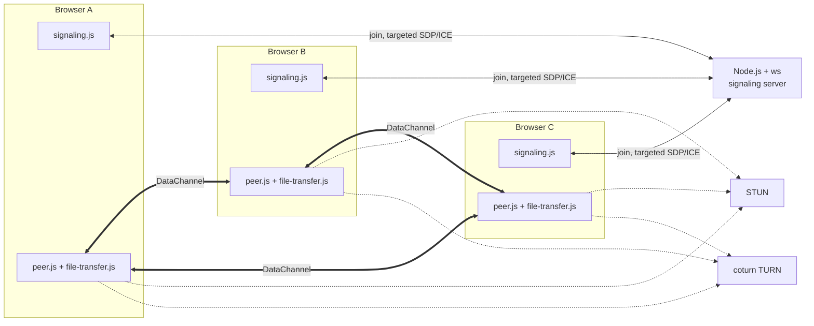

# Beam — peer-to-peer group chat and file transfer

Beam is a small group chat built on **WebRTC DataChannels**. Up to four people
(default) join a room, and every pair gets its own direct, DTLS-encrypted
connection. Chat text and files travel between browsers; the Node.js server only
introduces peers and enforces the room limit. The client is plain HTML, CSS and
vanilla JavaScript (ES2020); the server is Node.js with one dependency, `ws`.
There is no framework, build step or bundler.

## Features

- Group chat over a full mesh: one `RTCPeerConnection` and one DataChannel per
  remote peer, up to `MAX_PEERS_PER_ROOM` (default 4, range 2–8).
- Targeted signaling: offers, answers and ICE candidates are addressed to one
  peer; the server supplies the sender identity.
- Explicit statuses for connecting, waiting, negotiating, connected,
  reconnecting, failed and room-full, with a per-peer route summary.
- STUN and TURN configuration, plus `?relay=1` to force relay-only ICE.
- Simple capped exponential signaling reconnect (1, 2, 4, 8, then 10 seconds)
  and a 20-second server-side seat reservation so a short socket drop does not
  tear down live peer connections.
- Perfect negotiation, queued early ICE candidates, and up to three ICE restart
  attempts after a peer connection drops.
- Per-peer file sending with 16 KB binary chunks, `bufferedAmount`
  backpressure, progress cards and SHA-256 verification on receipt.
- All user-controlled text is rendered with `textContent`; no user data reaches
  `innerHTML`.
- Server heartbeat, room-name validation, WebSocket payload limits and static
  path-traversal protection.

## Project structure

```
.
├── client/
│   ├── index.html            page shell, join overlay, composer
│   ├── styles.css            all styling, status colors, progress bars
│   └── js/
│       ├── config.js         signaling URL, ICE servers, transfer settings
│       ├── signaling.js      WebSocket client, reconnect, targeted messages
│       ├── peer.js           one RTCPeerConnection per remote peer
│       ├── file-transfer.js  chunking, backpressure, SHA-256, reassembly
│       ├── ui.js             DOM rendering (textContent only)
│       └── app.js            mesh wiring, room lifecycle, status
├── server/
│   └── index.js              ws signaling server (+ static file convenience)
├── docker-compose.yml        coturn (TURN)
├── .env.example              TURN external IP and credentials
├── package.json
└── README.md
```

## Setup

Requirements: Node.js 18+ and a current Chromium or Firefox browser. Docker is
optional and only needed for TURN.

```bash
npm install
npm start
```

`npm start` serves the client and the signaling WebSocket on
**http://localhost:8080**. Open <http://localhost:8080/?room=demo>, then open the
same URL in two to four tabs or browsers. The join form appears when the URL has
no `?room=`.

To connect devices on the same Wi-Fi/LAN, start the server on one device and
open `http://<server-LAN-IP>:8080/?room=demo` on each device. The server listens
on all network interfaces by default, and the client derives its WebSocket
address from the page host, so `localhost` is not mistakenly used on the other
devices. Allow inbound TCP port 8080 in the server device's firewall.

For peers on different networks, host the page and signaling endpoint at a
publicly reachable address. Serve the page over HTTPS and provide WSS through a
TLS reverse proxy; browsers block insecure `ws://` connections from HTTPS pages.
STUN often enables a direct route, but restrictive NATs/firewalls need a
reachable TURN service as described below.

### Room limit

The default limit of 4 is enforced by the server:

```bash
# Git Bash / macOS / Linux
MAX_PEERS_PER_ROOM=3 npm start

# PowerShell
$env:MAX_PEERS_PER_ROOM=3; npm start
```

Values are clamped to 2–8. A room stays in the mesh model, so a higher limit
means every participant sends their chat and files once per peer. That is fine
for small groups; larger groups need an SFU.

Opening `client/index.html` directly also works if a signaling server is already
running at the configured URL.

### TURN (coturn)

```bash
cp .env.example .env        # optional: edit TURN_EXTERNAL_IP / credentials
docker compose up -d
docker compose logs -f coturn
```

Defaults, which match `client/js/config.js`:

| Setting       | Value                 |
| ------------- | --------------------- |
| TURN URL      | `turn:<page-host>:3478` |
| Username      | `chat`                |
| Password      | `chatpass`            |
| Relay ports   | UDP `49160-49200`     |
| Advertised IP | `127.0.0.1`           |

The defaults are intended for coturn running on the same machine as the page.
For peers on other networks, set `TURN_EXTERNAL_IP` to an address they can
reach, open TCP/UDP 3478 and UDP 49160–49200, and configure the public TURN
address and matching credentials using `turnUrls`, `turnUsername`, and
`turnCredential` in the page URL or `client/js/config.js`. Example:

```
?turnUrls=turn:turn.example.com:3478&turnUsername=myuser&turnCredential=mypass
```

In the URL, encode special characters in values (for example `&` as `%26`).
Static TURN credentials are visible to clients; use temporary credentials for
production deployments.

Force relay-only mode:

```
http://localhost:8080/?room=relay-test&relay=1
```

The Session panel should show a route **via TURN relay** for each connected
peer. Without a reachable TURN server, relay-only mode fails, which is the
expected negative result. `docker compose config --quiet` validates the Compose
file even when Docker Desktop is not running.

### Configuration

Settings live in `client/js/config.js`:

```js
window.CHAT_CONFIG = {
  signalingUrl: 'ws://localhost:8080', // normally derived from the page host
  iceServers: [/* STUN + TURN */],
  iceTransportPolicy: 'all', // 'relay' for relay-only
  fileTransfer: {
    chunkSize: 16 * 1024,
    bufferHighWaterMark: 1024 * 1024,
    bufferLowWaterMark: 256 * 1024,
    maxFileBytes: 100 * 1024 * 1024,
  },
  reconnect: { baseDelayMs: 1000, maxDelayMs: 10000 },
};
```

Per-session URL overrides:

| Query parameter      | Effect                                     |
| -------------------- | ------------------------------------------ |
| `?room=abc`          | Join room `abc` without the form           |
| `?signal=wss://host` | Override the signaling server URL          |
| `?relay=1`           | Set `iceTransportPolicy: 'relay'`          |
| `?turnUrls=...`      | Comma-separated TURN URL list              |
| `?turnUsername=...` / `?turnCredential=...` | TURN server credentials |

## How it works

### Mesh and signaling

For every remote peer, `app.js` keeps one entry with its own
`RTCPeerConnection`, DataChannel, file-transfer instance and route. The peer
with the higher server-assigned id initiates; the lower id is polite. That rule
is deterministic, and perfect negotiation handles any later glare.

The server implements a small room model:

```text
Map<room, Map<peerId, { peerId, clientId, ws, leaveTimer }>>
```

The signaling messages are:

| Direction | Message | Fields |
| --- | --- | --- |
| client → server | `join` | `room`, `clientId` |
| client → server | `leave` | — |
| client → server | `offer` / `answer` | `to`, `description` |
| client → server | `candidate` | `to`, `candidate` |
| server → client | `joined` | `room`, `peerId`, `clientId`, `resumed`, `limit`, `peers` |
| server → client | `peer-joined` | `peerId`, `clientId` |
| server → client | `peer-left` | `peerId` |
| server → client | `full` | `room`, `limit` |
| server → client | `offer` / `answer` / `candidate` | `from`, `fromClientId`, plus the payload |

The server ignores every other message type, including `chat`. Relay messages
are delivered to exactly one target, using the server's own view of the sender
so a client cannot impersonate another peer. Chat and file bytes never reach
Node.js.



### Reconnect behavior

There are two independent layers.

1. **Signaling socket.** `signaling.js` reconnects with a simple capped backoff
   and rejoins with the same client-generated `clientId`. The server keeps a
   disconnected member's seat for 20 seconds. Resuming within that window reuses
   the same peer id and does not announce `peer-joined` or `peer-left` to the
   room, so existing DataChannels stay intact. Intentional room exits send a
   `leave` message and release the seat immediately. There is no client
   application ping loop; the server uses the WebSocket protocol heartbeat
   every 30 seconds.
2. **Peer connection.** `peer.js` waits 2 seconds after `disconnected` for ICE to
   self-heal, restarts ICE on `failed`, and retries at most three times. A
   successful connection resets the retry count. ICE restart keeps the same
   `RTCPeerConnection` and DataChannel.

If the signaling server restarts and forgets all rooms, clients rejoin and get
new peer ids. `app.js` remaps an existing session by its remote `clientId`
instead of creating a second connection. Peer ids are random within the room
rather than a global counter, so ids from a previous server process cannot
collide with new ones.

### File transfer

1. The sender enforces `maxFileBytes` (100 MiB by default), reads the file once,
   computes SHA-256, and sends a JSON `file-meta` envelope with the digest.
2. The file is sent as ArrayBuffers containing an 8-byte header (transfer id,
   chunk index) followed by up to 16 KB of payload.
3. If `channel.bufferedAmount` exceeds 1 MiB, sending pauses until the
   `bufferedamountlow` event fires below 256 KiB. This keeps chat responsive and
   bounds SCTP memory.
4. The receiver validates the metadata, rejects duplicates and out-of-range
   chunks, and reassembles the file into a `Blob`.
5. On completion the receiver hashes the bytes and compares them with the
   metadata digest. The card shows **SHA-256 verified**, **SHA-256 mismatch**, or
   **Hash unavailable** when Web Crypto is unavailable (for example, plain HTTP
   on a LAN address rather than localhost).

Each peer has its own file-transfer instance. With several peers connected, the
selector in the composer chooses the recipient; chat is broadcast to all open
peers.

### Routes

After a peer connection opens, one `getStats()` read finds the selected
candidate pair. The Session panel classifies it as **direct** (showing the local
and remote candidate types) or **via TURN relay** if either side is a relay
candidate. It is not polled continuously; it is refreshed after an ICE restart.

### Security model

DataChannels use DTLS, and chat/file content stays between browsers or passes
through TURN still encrypted. All user-controlled content is rendered with
`textContent`. The static server resolves paths and rejects anything outside
`client/`, the signaling server caps WebSocket payloads at 256 KB, and room
names are trimmed and length-capped.

This is a demo, not a production security design:

- rooms have no authentication; anyone with the room name can take a seat;
- SDP is not authenticated, so a malicious signaling server could attempt a
  man-in-the-middle unless the signaling origin is trusted and served over WSS;
- TURN credentials are static and visible in the client;
- there is no rate limiting or persistence.

## Testing performed

Environment: Windows 11, Git Bash, Node `v24.16.0`, npm `11.17.0`, headless
Chrome driven through the DevTools Protocol. Docker 29.5.2 and Compose v5.1.4
were installed, but the Docker daemon was not running.

| Check | Method | Result |
| --- | --- | --- |
| JavaScript syntax | `node --check` on all server and client scripts | Pass |
| Static client | `GET /` | 200, served `index.html` |
| Path traversal | `GET /..%2fserver%2findex.js` | 403 |
| Three-peer room | Real `ws` clients | All joined; peer lists and notifications correct |
| Targeted relay | `offer`, `candidate`, `answer` with `to` | Delivered only to the target with server-supplied `from` |
| Chat isolation | Sent `{type:'chat'}` over signaling | Not relayed |
| Room limit | Fourth client with limit 3 | Received `full` |
| Reconnect grace | Closed one socket, waited 1.2 s | No premature `peer-left` |
| Seat resume | Rejoined with the same `clientId` | Same `peerId`, `resumed: true`, no re-notification |
| Grace expiry | Closed another socket and waited | `peer-left` after 20,002 ms; freed seat reusable |
| Three-tab mesh | Headless Chrome, same room | Each tab showed `2 connected · 2 in room · limit 4` |
| Group chat | Tab 0 and tab 1 sent messages | Both other tabs received each message once with `Peer <id>` labels |
| Per-peer file target | Sent from tab 0 to one selected peer | Only that peer received a card |
| File integrity | 40,000-byte multi-chunk file | Received bytes matched the sender's SHA-256; card said **SHA-256 verified** |
| Signaling outage | Stopped Node while three tabs were connected | Banner appeared; chat continued over existing DataChannels |
| Server restart | Restarted Node, waited for rejoin | All tabs reconnected, two targets per tab (no duplicates), post-restart message delivered exactly once |
| TURN Compose file | `docker compose config --quiet` | Valid configuration |

**Not tested here:** an actual relay-only WebRTC connection through coturn
(Docker daemon unavailable), real cross-network NAT traversal, physical
network-change ICE restart, and Firefox/Safari compatibility. These are listed
as manual checks rather than claimed results.

### Manual checklist

Run `npm start`; for TURN also start coturn.

- [ ] Open `/?room=demo` in two to four tabs and confirm every tab shows the
      others as connected.
- [ ] Send chat from each tab; every other tab receives it once with the sender
      label.
- [ ] With three tabs, choose a file recipient and send a file; only that peer
      gets a card, and the receiver reports **SHA-256 verified**.
- [ ] Open one more tab than `MAX_PEERS_PER_ROOM`; it reports room full.
- [ ] Stop the server with Ctrl+C while connected; send chat and a file — they
      still work and the banner reports signaling reconnection.
- [ ] Restart the server; tabs rejoin without duplicate connections or duplicate
      messages.
- [ ] Close a tab; after the 20-second grace period the others log that it left.
- [ ] Send `` as chat and as a file name; it appears
      as literal text.
- [ ] With coturn running, open `/?room=relay&relay=1` in two tabs and confirm
      the route says **via TURN relay**.
- [ ] Change networks on one device while connected and confirm the status moves
      through reconnecting and back to connected when a path is available.
- [ ] For cross-network use, serve over HTTPS and pass a `wss://` signaling URL;
      an HTTPS page cannot use plain `ws://`.

## Known limitations

- **Mesh scaling.** Every participant has a connection to every other
  participant. The default cap is 4 (configurable to 8), not a scalable group
  call design.
- **No authentication.** Room names are the only access control. Anyone who
  knows a room name can occupy a seat.
- **Signaling trust.** A malicious signaling server could rewrite SDP and
  attempt a man-in-the-middle. Use WSS and a trusted origin; this demo does not
  pin DTLS fingerprints.
- **Static TURN credentials** ship in the browser. Production should mint
  short-lived credentials server-side.
- **In-memory rooms.** A server restart forgets rooms and reassigns peer ids.
  Existing chats survive; clients remap sessions when they rejoin.
- **100 MiB file cap** and whole-file memory use: the sender reads the file to
  hash it, and the receiver holds all chunks before building the Blob. There is
  no streaming to disk, resume, or transfer history.
- **One outbound transfer per peer at a time.** Receiving while sending works,
  but a second simultaneous send to the same peer is rejected.
- **No persistence.** Reloading loses messages, transfer cards and room state.
- **Browser coverage.** Verified in current Chrome only. The code uses modern
  APIs such as parameterless `setLocalDescription()`, `connectionState`, and
  Web Crypto; recent Firefox and Safari should work but were not tested.
- **Secure-context caveat.** `crypto.subtle` (and the Clipboard API) may be
  unavailable on plain HTTP origins other than localhost. Transfers still work;
  hash verification is then reported as unavailable.
- **No group calls, presence, typing indicators, receipts or offline queues.**

## Viva notes

- **Why signaling is needed:** WebRTC has no rendezvous. SDP (DTLS fingerprints,
  ICE credentials, DataChannel parameters) and ICE candidates must be exchanged
  out of band. Once ICE succeeds, the server is out of the data path.
- **Why a mesh:** for 2–4 participants, a full mesh needs no media server.
  Each pair negotiates independently. The cost is O(n²) connections and uplink;
  an SFU is the alternative for larger rooms.
- **Perfect negotiation:** both sides may offer at once (initial setup or ICE
  restart). The polite peer rolls back and answers a colliding offer; the
  impolite peer ignores the incoming offer and keeps its own. One negotiation
  survives without a separate turn-taking protocol.
- **Candidate queueing:** `addIceCandidate()` fails before a remote description
  exists, and trickle candidates can arrive first. They are queued and flushed
  after `setRemoteDescription()`.
- **ICE restart vs new connection:** `restartIce()` uses new ICE credentials on
  the same `RTCPeerConnection`, preserving DTLS and the DataChannel. A new
  connection would redo SDP, DTLS and channel setup.
- **Backpressure:** `send()` only queues into the SCTP buffer. Sending a large
  file in a loop grows `bufferedAmount` without bound; pausing at a high-water
  mark and resuming on `bufferedamountlow` keeps chat responsive.
- **Why chunk headers are binary:** JSON-wrapping every 16 KB chunk adds base64
  inflation and encode/decode overhead; an 8-byte binary header keeps the
  transfer efficient while the metadata still travels as JSON.
- **Reconnect identity:** the client-generated `clientId` lets the server
  reserve a seat for 20 seconds, so a brief socket drop does not cause the room
  to tear down working peer connections. After a full server restart, the client
  remaps existing sessions by `clientId`.
- **Route detection:** `getStats()` exposes the selected candidate pair. If
  either candidate is type `relay`, traffic used TURN; otherwise it is direct
  (`host` or `srflx`).
- **Dead socket cleanup:** the server pings every 30 seconds and terminates
  sockets that miss a pong. Disconnected seats expire after the grace period.

## License

Demo code for a technical recruitment task. Use and modify freely.
